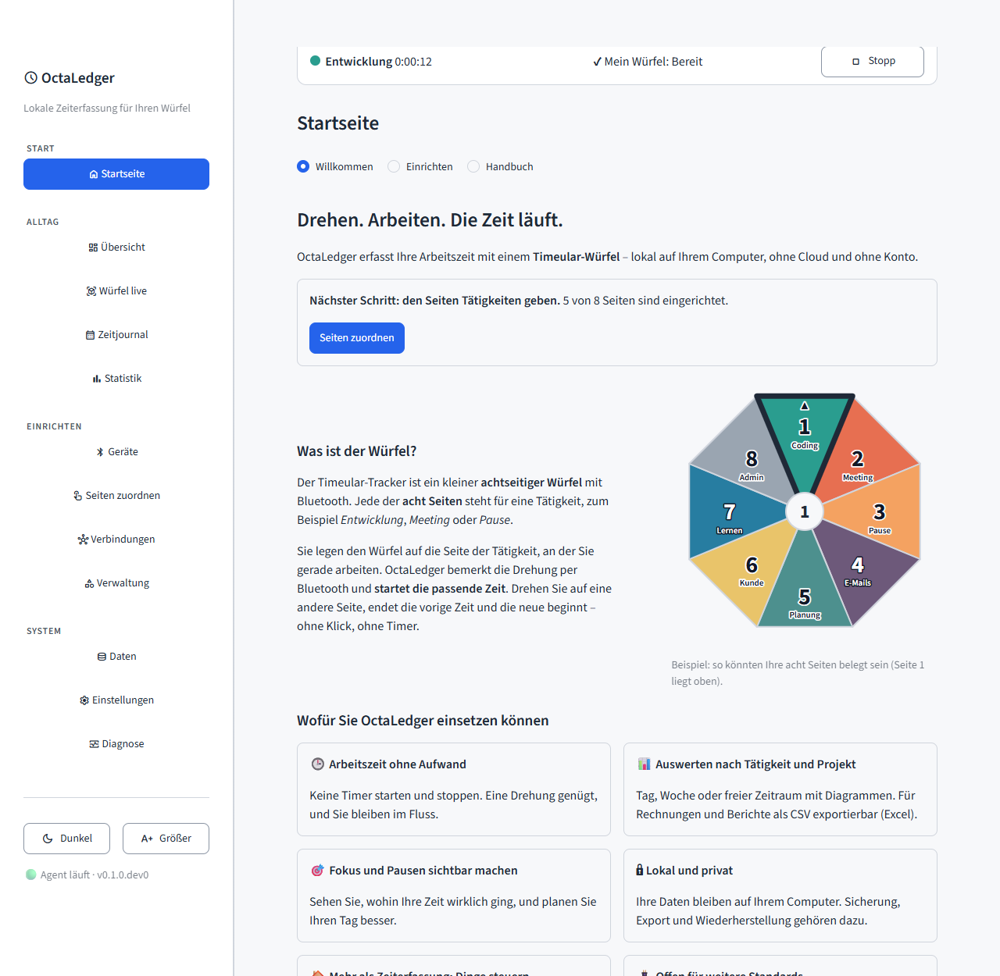
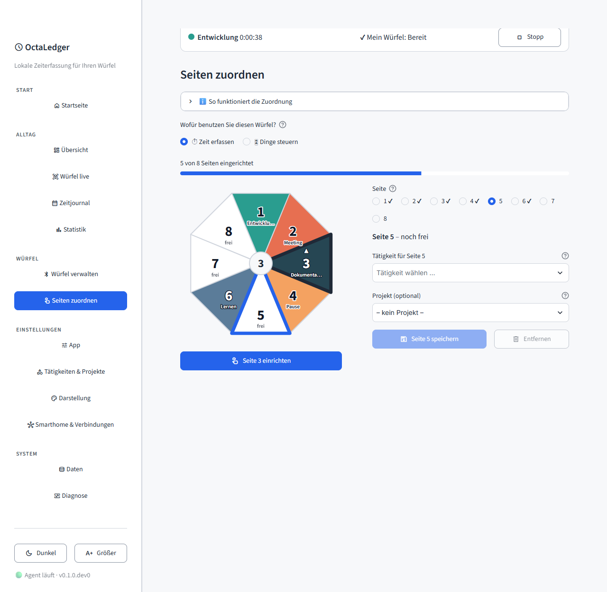
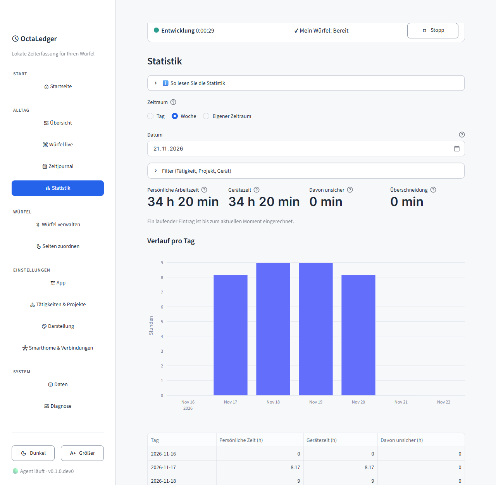
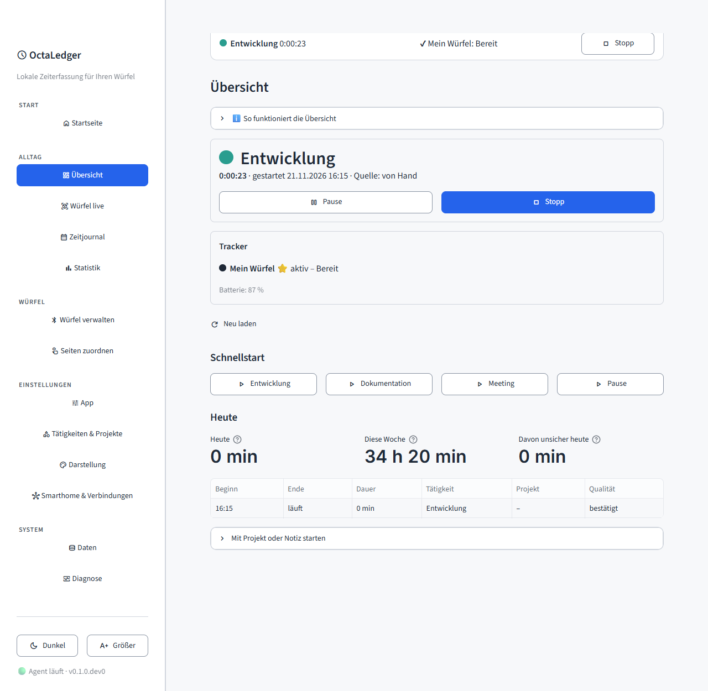
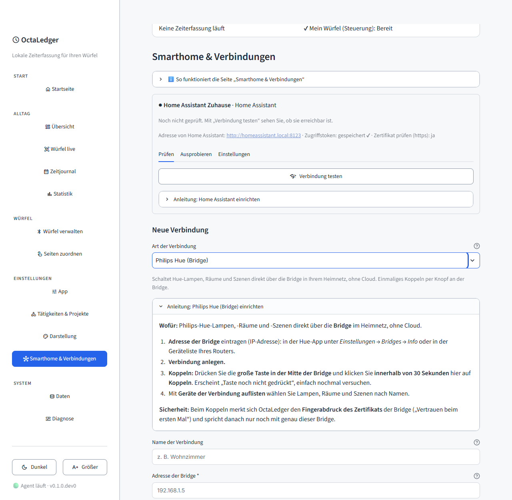
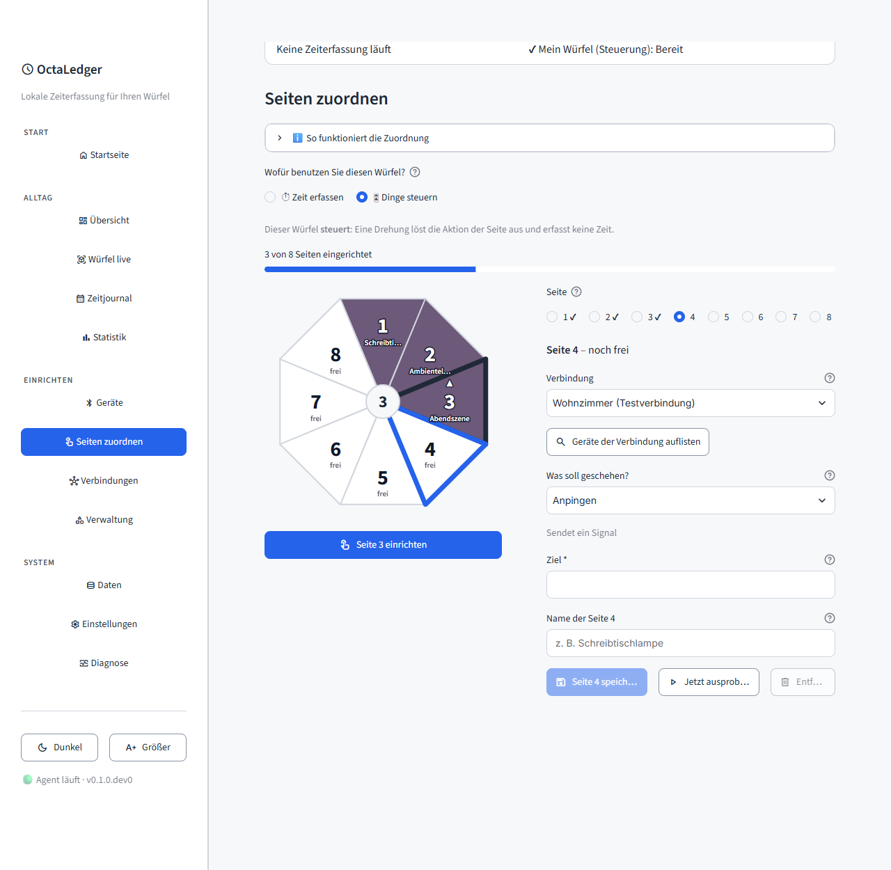
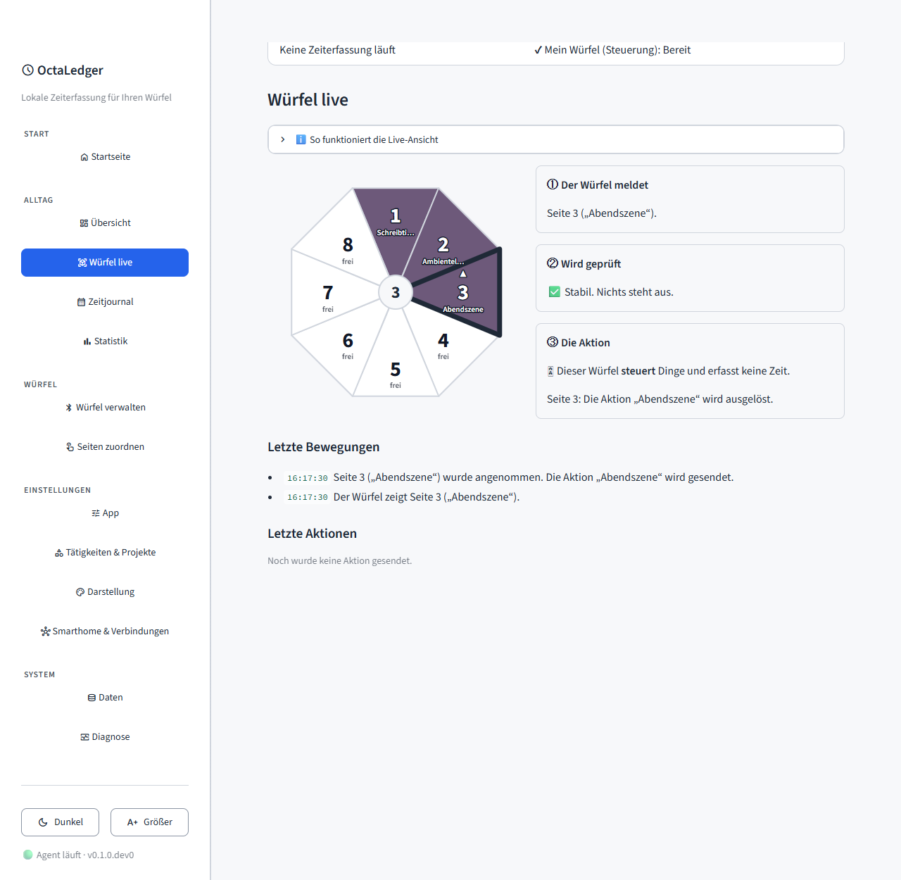
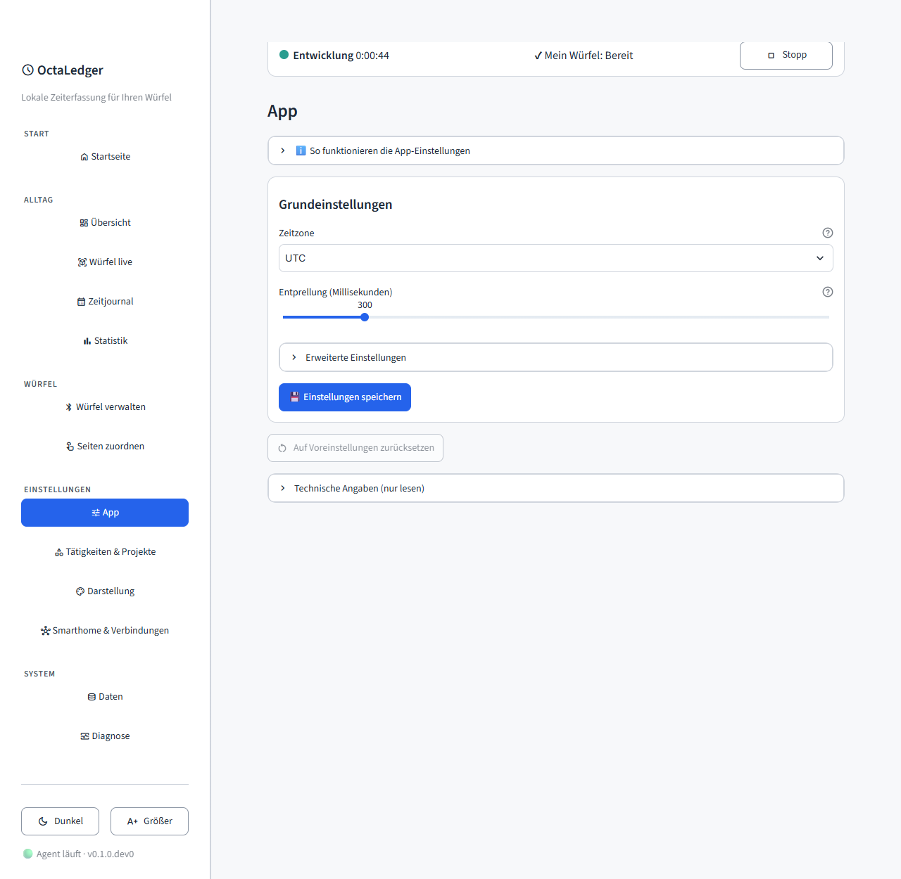
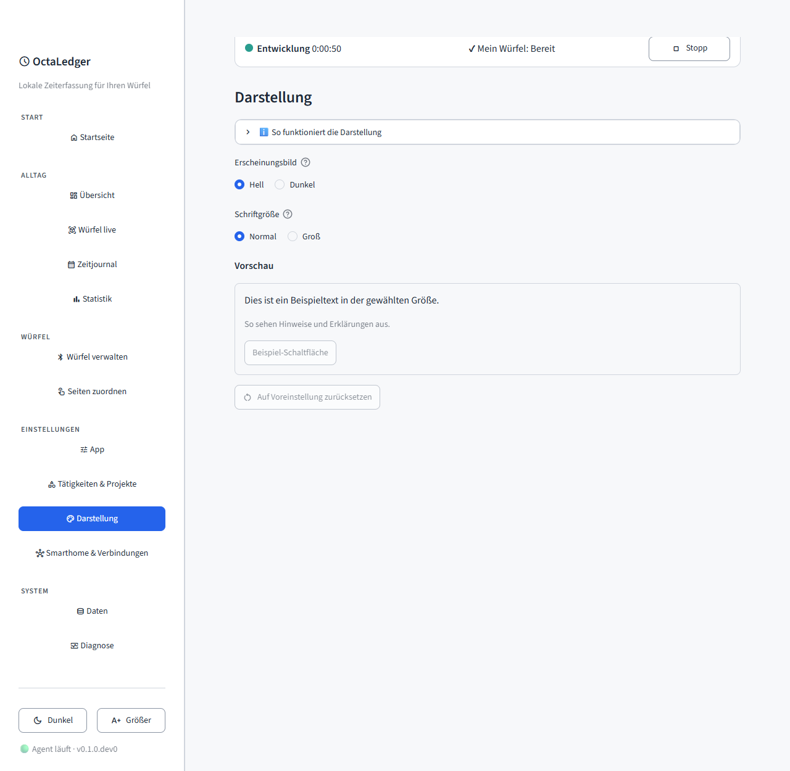
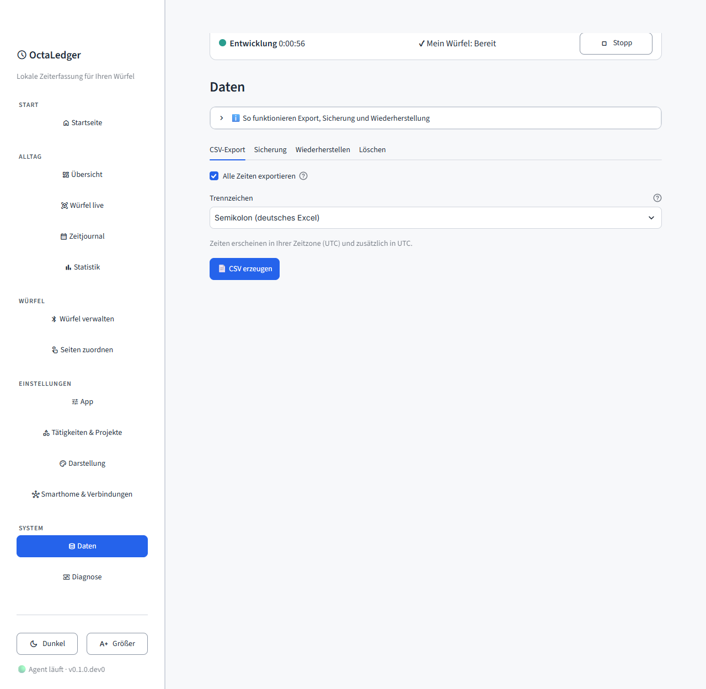

# OctaLedger

**Drehen. Arbeiten. Die Zeit läuft – oder das Licht geht an.**

OctaLedger verbindet einen **Timeular-/ZEI-Bluetooth-Würfel** mit Ihrem Windows-Rechner. Jede der acht Seiten des Würfels ist entweder eine
**Tätigkeit** (dann erfasst OctaLedger Ihre Arbeitszeit) oder eine **Aktion** (dann schaltet OctaLedger etwas: Licht, Szenen, Nachrichten an Ihr Smarthome).
Alles läuft **lokal**: kein Konto, keine Cloud, keine Telemetrie.



> Das Projekt ist unabhängig von Timeular und EARLY und nicht mit deren Herstellern verbunden.

**Inhalt**

1. [Was kann OctaLedger?](#was-kann-octaledger)
2. [Status – ehrlich](#status--ehrlich)
3. [Schnellstart](#schnellstart-windows)
4. [Zeiterfassung](#zeiterfassung)
5. [Steuerungsmodus: Dinge schalten](#steuerungsmodus-dinge-schalten)
6. [Die Oberfläche](#die-oberfläche)
7. [Architektur](#architektur)
8. [Sicherheit und Datenschutz](#sicherheit-und-datenschutz)
9. [Dokumentation](#dokumentation)
10. [Entwickeln und beitragen](#entwickeln-und-beitragen)
11. [Lizenz](#lizenz)

## Was kann OctaLedger?

| | Zeitmodus (Standard) | Steuerungsmodus |
|---|---|---|
| **Was eine Seite ist** | eine Tätigkeit (z. B. „Meeting“) | eine Aktion (z. B. „Schreibtischlampe an“) |
| **Was beim Drehen passiert** | die vorige Zeit endet, die neue beginnt | die Aktion wird ausgelöst |
| **Ergebnis** | Zeitjournal, Statistik, CSV-Export | geschaltetes Licht, Szene, MQTT-Nachricht … |
| **Umschalten** | **pro Würfel** – mit zwei Würfeln kann einer Zeit erfassen und der andere steuern | |

Dazu:

* **Robuste Erfassung:** Entprellung gegen Fehlwechsel, Baseline-Regel (die erste Meldung startet nichts), automatische Wiederverbindung, Lücken werden als
  *unsicher* markiert und von Ihnen bestätigt – es wird nie Historie erfunden.
* **Korrekturen mit Prüfspur:** jede Änderung mit Grund, Vorher/Nachher und Zeitpunkt.
* **Zwei Würfel:** beide registrierbar, nur der aktive erzeugt Zeiten; Übergabe ohne doppelte Zeit.
* **Daten im Griff:** atomares Speichern, versionierte Migrationen mit automatischer Kopie, CSV (Excel-tauglich, gegen Formel-Injektion geschützt), JSON-Sicherung mit Prüfsumme,
  **vollständig geprüfte** Wiederherstellung mit Vorschau.
* **Eine Oberfläche, die erklärt:** Startseite mit geführter Einrichtung, Handbuch im Programm, Hilfetext an jedem Feld, **Live-Ansicht**, in der man den Würfel in Echtzeit
  „sehen“ kann.

## Status – ehrlich

| Bereich | Stand |
|---|---|
| Software (Agent, Datenbank, API, Dashboard, Export/Sicherung, Steuerungsmodus, CLI) | **vollständig umgesetzt** |
| Automatische Tests | **1377 bestanden, 4 übersprungen** (2 Hardwaretests bewusst, 2 plattformbedingt) (Windows 11, Python 3.12); `ruff` und `mypy --strict` sauber |
| Echte Tracker-Hardware | **noch nicht geprüft** – bisher nur mit einem Simulator getestet |
| Bluetooth-Protokoll | Community-Referenz, **nicht** hardwarevalidiert (Kompatibilität pro Exemplar/Firmware prüfen) |
| Anbindungen im Steuerungsmodus | gegen **lokale Testserver und Fake-Broker** getestet; **nicht** gegen echte Home-Assistant-/Hue-/MQTT-Installationen; echter TLS-Handshake mit einer Hue-Bridge ungeprüft |
| Lizenz | **noch nicht gewählt** – ohne Lizenz ist veröffentlichter Code nicht frei nachnutzbar |

Details und Nachweise: [FORTSCHRITT](docs/FORTSCHRITT.md), [TESTPLAN](docs/TESTPLAN.md), [QUELLEN_UND_GRENZEN](docs/QUELLEN_UND_GRENZEN.md).

## Schnellstart (Windows)

Voraussetzungen: Windows 10/11 mit Bluetooth 4.0+, Python 3.12.

```bat
py -3.12 -m venv .venv
.venv\Scripts\python.exe -m pip install -e ".[dev]" -c constraints-tested.txt
scripts\start_all.bat
```

`start_all.bat` startet den **Agenten** (Hintergrunderfassung, API auf `127.0.0.1:8765`) und das **Dashboard** (`http://127.0.0.1:8501`). Einzeln:
`octaledger agent` und `octaledger dashboard`; Speicherorte zeigt `octaledger paths`.

Beim ersten Start führt die **Startseite** durch alles: Würfel finden (Knopf am Würfel drücken, bis er blau blinkt), benennen, Seiten zuordnen. Ausführlich:
[Installation](docs/INSTALLATION.md) und der [Schnellstart im Benutzerhandbuch](docs/BENUTZERHANDBUCH.md#3-schnellstart-in-10-minuten).

Qualitätsprüfung: `scripts\run_tests.bat` (pytest, ruff, ruff format --check, mypy).

## Zeiterfassung

Seiten zuordnen – mit einem Klick pro Seite, geführt vom Würfel selbst („Drehen Sie jetzt die Seite, die Sie meinen“):



Auswertung nach Tag, Woche oder Zeitraum, mit Filter nach Tätigkeit, Projekt und Gerät – Gerätezeit und persönliche Zeit getrennt, damit Überschneidungen nie doppelt zählen:



Die **Übersicht** zeigt, was gerade läuft, mit Schnellstart, Pause und Stopp:



## Steuerungsmodus: Dinge schalten

Schalten Sie einen Würfel auf **Steuerung**, und jede Seite löst eine **Aktion** aus. Verbindungen legen Sie auf der Seite **Smarthome & Verbindungen** an (mit Anleitung, Grund- und erweiterter Ansicht); die Formulare entstehen
automatisch aus der Selbstbeschreibung der jeweiligen Verbindungsart.

| Verbindung | Wofür | Hinweise |
|---|---|---|
| **Home Assistant** | der **Hub**: einschalten/ausschalten/umschalten, Szenen, Skripte, beliebige Dienste | der Weg zu **Matter** und **Google Home** (beide hängen an Home Assistant); Geräte per „Entdecken“ auswählen |
| **Philips Hue** | Lampen, Räume, Szenen direkt über die Bridge im Heimnetz | Kopplung per Bridge-Taste, Zertifikat-Anheftung beim ersten Mal |
| **MQTT** | Nachrichten an einen Broker (Zigbee2MQTT, Tasmota, ESPHome, Node-RED …) | QoS 0/1, TLS, eigener schlanker MQTT-3.1.1-Sender |
| **Webhook** | beliebige Web-Anfrage | die Notlösung für alles mit einfacher Web-Schnittstelle (IFTTT, Node-RED, eigene Skripte) |



Jede Seite bekommt ihre Aktion im selben Assistenten wie die Tätigkeiten:



In der **Live-Ansicht** sehen Sie in Echtzeit, wie der Würfel liegt, was geprüft wird und welche Aktion ausgelöst wird:



**Zuverlässig und vorsichtig:**

* Eine Aktion wird **zuerst gespeichert** (in derselben Transaktion wie das auslösende Ereignis) und dann gesendet – kein Verlust, keine Doppelsendung.
* Sie **verfällt nach 30 Sekunden**: Ein Licht, das eine Minute zu spät angeht, wäre ein Fehler.
* **Wiederholt** wird nur, wenn die Anfrage **sicher nicht angekommen** ist (höchstens 3 Versuche) – eine doppelt geschaltete Lampe ist schlimmer als eine, die der Verlauf als gescheitert zeigt.
* **Zugangsdaten** liegen getrennt (`secrets.json`), **nie** in Datenbank, Sicherung, API-Antwort oder Protokoll.
* Im Steuerungsmodus entstehen **keine Zeiten**; Baseline und „neutral“ lösen nichts aus.

Eigene Anbindung nötig? Ein neuer **Adapter** ist eine Datei und eine Zeile: [Anleitung mit Beispiel](docs/ADAPTER_ENTWICKLUNG.md).

## Die Oberfläche

Das Dashboard (Streamlit) hat **18 Seiten in 6 Gruppen**. Jede **Art von Einstellung hat ihre eigene Seite**:

| Gruppe | Seiten |
|---|---|
| **Start** | Startseite (Erklärung, geführte Einrichtung, Handbuch) |
| **Alltag** | Übersicht, Würfel live, Musik-Player |
| **Zeiten** | Zeitjournal, **Einträge** (suchen, filtern, gesammelt bearbeiten), **Diagramme** (17 interaktive Grafiken), Statistik |
| **Würfel** | Würfel verwalten (hinzufügen, verbinden, Kopplung aufheben, entfernen), Würfel-Inspektor, Würfel-Datenblatt, Seiten zuordnen |
| **Einstellungen** | **App** (Zeiterfassung), Tätigkeiten & Projekte, **Darstellung** (Hell/Dunkel, Schrift), **Smarthome & Verbindungen** |
| **System** | Daten (Export, Sicherung, Import, gezieltes Löschen, Zurücksetzen), Diagnose |

Einstellungen zeigen zuerst die **Grundansicht**; Seltenes steht in eingeklappten **Erweiterten Einstellungen**, jede Einstellung hat Voreinstellung und Hilfetext, und
Löschen folgt immer dem Muster *Vorschau → Bestätigung mit der Zahl → automatische Sicherung vorher*.

**App-Einstellungen** – zuerst die Grundeinstellungen, Seltenes eingeklappt, jede Einstellung mit Voreinstellung und Hilfetext, ein Knopf stellt alles zurück:



**Darstellung** (wirkt sofort) und **Daten** (Export, Sicherung, Wiederherstellung/Import und Löschen mit Vorschau und automatischer Sicherung):





Auf jeder Seite: Statusleiste (läuft etwas? Würfel verbunden? etwas zu tun?), ein ausklappbares „So funktioniert diese Seite“, Hilfetext an jedem Eingabefeld, verständliche
deutsche Fehlermeldungen mit Code, Hell-/Dunkel-Umschalter, zwei Schriftgrößen. Konzept und Recherche: [GUI_KONZEPT](docs/GUI_KONZEPT.md).

## Architektur

```text
Würfel (BLE) ──► AGENT ──────────────────────────────────────────────────────┐
                 BLE-Thread: ein asyncio-Loop, ein Worker je Würfel          │
                   Entprellung/Baseline ──► Tracking-Service                 │
                                              ├─ Zeitmodus:    Sitzungen     │
                                              └─ Steuerungsmodus: Aktion ──►  Warteschlange (Outbox)
                 API-Thread (FastAPI, nur 127.0.0.1, Token)                  │
                 Dispatcher-Thread ──► Adapter: Home Assistant · Hue · MQTT · Webhook
                 SQLite (ein Schreiber)                                      │
                                                                             │
Dashboard (Streamlit) ◄── nur über die API, kein SQL, kein BLE ──────────────┘
```

Schichten: `domain` → `application` → `infrastructure` / `api` / `agent`; das Dashboard spricht nur über den `dashboard_client` mit der API. Der **Agent** ist ein gewöhnlicher
Hintergrunddienst (**kein KI-Agent**, kein Sprachmodell): Er hält die Bluetooth-Verbindung, damit die Erfassung weiterläuft, auch wenn der Browser geschlossen ist.
Mehr in [ARCHITEKTUR](docs/ARCHITEKTUR.md), [DATENMODELL](docs/DATENMODELL.md) und der [API-Referenz](docs/API.md).

## Sicherheit und Datenschutz

* Die API hört **nur auf `127.0.0.1`**, verlangt ein **Token** (nur im Header), prüft **Host und Origin** (CSRF/DNS-Rebinding).
* **Keine BLE-Schreibzugriffe** – OctaLedger liest nur vom Würfel.
* Tokens, Passwörter und Bluetooth-Adressen werden im **Protokoll geschwärzt**; Zugangsdaten stehen nie in Sicherungen.
* Adapter folgen **keinen Weiterleitungen**, ignorieren Umgebungs-Proxys und haben Zeitlimits.
* Sicherungen werden vor dem Einspielen **vollständig geprüft**; CSV-Zellen sind gegen Formel-Injektion geschützt.
* Alle Daten liegen im **Benutzerprofil** (nicht im Projektordner) und werden nirgends hingesendet.

Bedrohungen, Maßnahmen und ehrliche Grenzen (z. B. unverschlüsselte `secrets.json`): [SECURITY](SECURITY.md).

## Dokumentation

Wegweiser nach Zielgruppe: **[docs/README.md](docs/README.md)**. Das Benutzerhandbuch lesen Sie auch direkt im Programm auf der Startseite.

| Zielgruppe | Dokument |
|---|---|
| **Anwender** | [Benutzerhandbuch](docs/BENUTZERHANDBUCH.md) (inkl. Kapitel 20 „Dinge steuern“), [Installation und Betrieb](docs/INSTALLATION.md), [Glossar](docs/GLOSSAR.md) |
| **Entwickler** | [Architektur](docs/ARCHITEKTUR.md), [Softwaredokumentation](docs/SOFTWAREDOKUMENTATION.md), [API-Referenz](docs/API.md), [Datenmodell](docs/DATENMODELL.md), [Adapter-Entwicklung](docs/ADAPTER_ENTWICKLUNG.md), [BLE-Protokoll](docs/BLE_PROTOCOL.md), [Ordnerstruktur](docs/ORDNERSTRUKTUR.md) |
| **Anforderungen & Planung** | [Pflichtenheft](docs/PFLICHTENHEFT.md), [Umsetzungsplan der nächsten Erweiterungen](docs/UMSETZUNGSPLAN.md), [Roadmap](docs/ROADMAP.md), [Tests](docs/TESTPLAN.md), [Fortschritt](docs/FORTSCHRITT.md), [Änderungen](CHANGELOG.md) |
| **Sicherheit, Grenzen, Quellen** | [Sicherheit](SECURITY.md), [Quellen und Grenzen](docs/QUELLEN_UND_GRENZEN.md) |
| **Gestaltung** | [GUI-Konzept](docs/GUI_KONZEPT.md) |
| **Mitarbeit & LLM-Agenten** | [CONTRIBUTING](CONTRIBUTING.md), [CLAUDE.md](CLAUDE.md), [AGENTS.md](AGENTS.md), [GitHub](docs/GITHUB.md) |

Auch der **Quelltext ist dokumentiert**: Jedes Modul beginnt mit einem Docstring (Aufgabe, Regeln, Grenzen), jede Klasse und Funktion hat einen, Kommentare erklären das Warum.
Ein Test stellt sicher, dass das so bleibt (und dass jeder Endpunkt in der API-Referenz steht).

## Entwickeln und beitragen

```bat
scripts\run_tests.bat
rem entspricht: pytest, ruff check, ruff format --check, mypy (strict)
```

Regeln für Menschen **und** LLM-Agenten stehen in [CLAUDE.md](CLAUDE.md), die Kurzfassung samt Rezepten (Fehlercode, Migration, Endpunkt, Seite, Adapter) in
[CONTRIBUTING.md](CONTRIBUTING.md). Code und Kommentare sind englisch, Oberfläche und Benutzerdokumentation deutsch.

Keine echten Zeitdaten, Datenbanken, Logs oder Tokens ins Repository aufnehmen.

## Lizenz

Die Vorlage enthält bewusst **keine gewählte Open-Source-Lizenz**. **Vor einer Veröffentlichung muss eine Lizenz festgelegt werden** (z. B. MIT oder Apache-2.0 –
die Wahl liegt beim Projektinhaber). Öffentlicher Quellcode ist ohne Lizenz nicht automatisch frei nachnutzbar.
